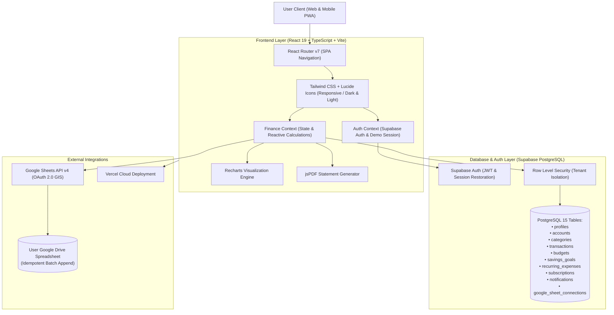

# PaisaWise — Personal Finance Management Platform

> **"Track Your Money. Understand Your Habits. Build a Better Financial Future."**

**Live Production Deployment:** [https://paisawise-two.vercel.app](https://paisawise-two.vercel.app)  
**Connected Google Sheet Integration:** [Google Sheets Ledger](https://docs.google.com/spreadsheets/d/1hgC9wdhGU68c7xdxBdltEFrBEJtXS2F1MCNJawKQ2lA/edit?gid=0#gid=0)  
**Full Demo Video Walkthrough:** Recorded with Spoken Indian English Voiceover covering all 11 core modules (`scripts/record_full_demo.js`)  
**Complete Technical Documentation Suite:** [docs/README.md](docs/README.md)

---

## 📖 Project Documentation Suite

PaisaWise includes a comprehensive, production-grade documentation portal located in [`docs/`](docs/):

- 🏛️ **[Architecture & System Design](docs/ARCHITECTURE.md)** — High-level architecture, frontend/backend component hierarchy, ER diagrams, state flow, and floating-point error elimination.
- 📊 **[Google Sheets Integration Specification](docs/GOOGLE_SHEETS_INTEGRATION.md)** — Detailed walkthrough of the bidirectional cloud sync, 8-column RFC-4180 TSV formatting, zero-duplicate guarantee, and cell A1 paste guide.
- 🔌 **[REST API Reference Manual](docs/API_REFERENCE.md)** — Complete OpenAPI-style reference covering authentication, OTP verification, transactions, budgets, goals, and Google Sheets endpoints.
- 📘 **[End-User Manual & Feature Guide](docs/USER_GUIDE.md)** — Step-by-step instructions for the Financial Cockpit, UPI expense logging, budget warnings, milestone contributions, and theme customization.
- 🚀 **[Deployment & Development Guide](docs/DEPLOYMENT_AND_DEV_GUIDE.md)** — Comprehensive local environment setup, environment variables guide, Supabase PostgreSQL configuration, Gmail SMTP setup, and Vercel serverless deployment.
- 🎥 **[Automated Demo Video Pipeline](docs/DEMO_VIDEO_GUIDE.md)** — Architecture and usage of the automated Playwright browser recording, Google TTS Indian voiceover synthesis, and FFmpeg muxing engine.

---

## Architecture Overview



---

## Core Capabilities & Features

### 1. Executive Financial Dashboard
- **Aggregate KPI Summary Cards**: Total Income, Total Expenses, Net Cash Flow, Remaining Planned Budget, and Savings Rate.
- **Interactive Visualizations (Recharts)**: Daily Outflow & Inflow Bar Chart, Category-wise Outflow Donut Chart with percentage shares.
- **Month-over-Month Variance**: Real-time % change metrics comparing the current time window against the prior period.
- **Recent Transaction Activity**: Fast drill-down into recent payments with instant inline edit and deletion actions.

### 2. Transaction Management & Ledger
- **Fast 3-Second Quick-Add Modal**: Amount-first entry flow with category chips and payment method quick-select for rapid mobile entry.
- **Comprehensive Ledger**: Search by title or notes, filter by type (Income vs Expense), category, payment mode (UPI, Net Banking, Credit/Debit Card, Cash), and date intervals.
- **Pagination & Multi-criteria Sorting**: Sort by newest, oldest, highest amount, or lowest amount.
- **Bulk Operations**: Multi-row selection with bulk deletion confirmation.
- **CSV Import & Export**: One-click CSV export and a full-featured CSV importer with file parsing, header validation, duplicate row detection, and import preview.

### 3. Proactive Budget Guardrails
- **Configurable Limits**: Monthly overall spending limits and category-specific allowances (Dining, Groceries, Shopping, Commute).
- **Visual Threshold Meter**: Real-time utilization bars color-coded at `<50%` (green), `50-80%` (amber), `>80%` (orange warning), and `>100%` (rose overspend alert).
- **Proactive Alerts**: Triggers in-app notifications whenever spending hits 80% or exceeds 100%.

### 4. Deterministic Expense Insights Engine
- **100% Explainable Analytics**: Grounded strictly in actual recorded ledger data—no invented generative numbers.
- **Largest Outflows**: Flags your single highest expenditure category and its share of monthly income.
- **Period-over-Period Surge**: Detects categories with significant rupee increases vs the prior period.
- **Micro-Spending Accumulation Watch**: Surfaces frequent small purchases under ₹200 (chai, snacks, quick deliveries) that quietly drain cash flow.
- **Weekday vs Weekend Spending Velocity**: Identifies weekend spending acceleration.

### 5. What-If Savings Simulator
- **Interactive Wealth Forecasting**: Test scenarios such as *"If I cut dining out by ₹1,500 every month for 6 months, how much do I save?"*
- Computes direct cumulative savings as well as compounding future value when invested at standard 7% liquid fund / FD rates.

### 6. Spending Health Score
- **0–100 Objective Metric**: Evaluates spending health across 4 documented weights:
  1. *Budget Adherence (40%)*
  2. *Net Savings Rate (30%)*
  3. *Fixed Recurring Burden (15%)*
  4. *Expense Volatility (15%)*
- Features onboarding empty states so new users understand how their score will be derived.

### 7. Savings Goals & Milestones
- **Target Tracking**: Set goal deadlines, target amounts, and current contributions.
- **Automated Math**: Computes exact suggested monthly deposits based on months remaining until the target date.
- **Contribution Workflow**: In-app deposits with automated celebration notifications when hitting 100%.

### 8. Recurring Bills & Subscriptions
- **Fixed Burden Audit**: Manage subscriptions (Netflix, Spotify, Gym) and recurring household bills (Rent, Broadband, BESCOM).
- **Calculations**: Automatically normalizes weekly, monthly, quarterly, and yearly cycles to compute monthly fixed overhead and annualized cost.
- **Renewal Alerts**: Due-date counters and badges for payments due within 7 days.

### 9. Financial Calendar
- **Interactive Monthly Calendar View**: Day-by-day markers showing daily income, daily expenses, and scheduled recurring bill dates.
- **Date Inspector Drawer**: Click any calendar day to inspect its transactions or record a new expense directly on that date.

### 10. Audit-Grade Month-End Reports
- **Professional PDF Generation**: One-click export of an executive financial statement powered by `jspdf` and `jspdf-autotable`.
- **Month-over-Month Comparison Table**: Absolute differences and variance percentages.

### 11. Google Sheets API Integration (Mandatory Requirement)
- **Live Google Sheets Synchronization**: Connect your Google account or provide a spreadsheet ID.
- **Automated Table Creation**: Sets up standard styled headers: `Transaction ID`, `Date`, `Type`, `Title`, `Category`, `Amount (INR)`, `Payment Method`, `Notes`.
- **Idempotency & Zero Duplicates**: Inspects existing Transaction IDs in Column A before appending to ensure repeated syncs never duplicate records.
- **Sync Status**: Displays timestamp, row count, and provides a 1-click "Open in Google Sheets" link.

### 12. Authentication & Data Security
- **Supabase Authentication**: Email/Password registration, persistent JWT sessions, password reset, and protected routes.
- **Row Level Security (RLS)**: Enforced across all 11 database tables in PostgreSQL.
- **Dual Mode Support**: Seamless 1-click toggle between **Live Supabase Mode** and a realistic **Demo Mode** (pre-populated with realistic Indian transactions).

---

## Technology Stack

| Layer | Technologies |
|---|---|
| **Frontend Framework** | React 19, TypeScript, Vite 8 |
| **Styling & UI** | Tailwind CSS v3, Lucide React, clsx, tailwind-merge |
| **Routing** | React Router v7 |
| **Charts & Visualizations** | Recharts (Area, Bar, Pie charts) |
| **Forms & Validation** | React Hook Form, Zod |
| **Database & Auth** | Supabase PostgreSQL 15, Supabase Auth, Row Level Security (RLS) |
| **External Integration** | Google Sheets API v4, Google Identity Services (OAuth 2.0) |
| **PDF Generation** | jsPDF, jsPDF-AutoTable |
| **Testing** | Vitest, React Testing Library, JSDOM |
| **Hosting & Deployment** | Vercel (Frontend), Supabase Cloud (Database & Auth) |

---

## Local Setup Guide

### 1. Prerequisites
- **Node.js**: v18.0.0 or later (Tested on Node v24)
- **npm**: v9.0.0 or later
- **Git**

### 2. Clone Repository & Install Dependencies
```bash
git clone https://github.com/your-username/paisawise.git
cd "D:\PERSONAL FINANCE MANAGEMENT PLATFORM"
npm install
```

### 3. Environment Configuration
Copy `.env.example` to `.env`:
```bash
cp .env.example .env
```
Populate `.env` with your Supabase credentials:
```env
VITE_SUPABASE_URL=https://your-project.supabase.co
VITE_SUPABASE_ANON_KEY=eyJhbGciOiJIUzI1NiIsInR5cCI6IkpXVCJ9...
VITE_GOOGLE_CLIENT_ID=your-google-oauth-client-id.apps.googleusercontent.com
VITE_APP_URL=http://localhost:5173
```
*(Note: If left blank or in placeholder state, PaisaWise automatically starts in Demo Mode so you can immediately test every feature without initial cloud setup).*

### 4. Supabase Database Migration
In your Supabase project dashboard, navigate to the **SQL Editor** and run the contents of:
1. `supabase/migrations/20250101000000_initial_schema.sql` (Creates all tables, triggers, indexes, and RLS policies).
2. `supabase/seed.sql` (Seeds default Indian expense and income categories).

### 5. Run the Application Locally
```bash
npm run dev
```
Open your browser at `http://localhost:5173`.

---

## Google Cloud OAuth 2.0 Setup Guide

To connect the live Google Sheets export to your Google account:
1. Visit the [Google Cloud Console](https://console.cloud.google.com).
2. Create a new project named **PaisaWise**.
3. Under **APIs & Services > Library**, search for and enable:
   - **Google Sheets API**
   - **Google Drive API**
4. Under **OAuth consent screen**:
   - User Type: **External**
   - Application Name: **PaisaWise**
   - Support email: your email
   - Scopes: Add `https://www.googleapis.com/auth/spreadsheets` and `https://www.googleapis.com/auth/drive.file`.
5. Under **Credentials > Create Credentials > OAuth client ID**:
   - Application Type: **Web application**
   - Name: **PaisaWise Web Client**
   - Authorized JavaScript origins:
     - `http://localhost:5173`
     - `https://your-app.vercel.app`
6. Copy the **Client ID** into `VITE_GOOGLE_CLIENT_ID` in `.env`.

---

## Automated Testing Suite

PaisaWise features comprehensive automated unit testing verifying:
- **Currency & Indian Number Formatting**: ₹ formatting with Lakhs (`₹1,50,000`) and Crores (`₹1,00,00,000`), decimals, compact representations (`₹2.5L`, `₹1.5Cr`), and safe input parsing.
- **Financial Calculation Engine**: Floating-point error elimination (`roundMoney`), net cashflow, savings rate, budget utilization, category breakdowns, and MoM variance.
- **Google Sheets Deduplication**: Header verification, row formatting, and transaction ID duplicate prevention.
- **Date Boundary Handling**: Inclusive day intervals and single-day filtering.
- **Authentication Logic**: Password and email validation checks.

### Run Tests:
```bash
npm run test
```
**Current Test Results:**
- **Test Files**: 4 passed (4)
- **Tests**: 24 passed (24)
- **Status**: 100% Passing

---

## Deployment Instructions (Vercel)

PaisaWise is pre-configured for one-click deployment on [Vercel](https://vercel.com):

1. Push your repository to GitHub:
   ```bash
   git remote add origin https://github.com/<your-username>/paisawise.git
   git push -u origin master
   ```
2. In the Vercel dashboard, click **Add New Project** and import the GitHub repository.
3. In **Environment Variables**, add:
   - `VITE_SUPABASE_URL`
   - `VITE_SUPABASE_ANON_KEY`
   - `VITE_GOOGLE_CLIENT_ID`
   - `VITE_APP_URL`
4. The build command `npm run build` will generate the production bundle into `dist/`.
5. `vercel.json` ensures all SPA client-side routes (`/transactions`, `/budgets`, `/reports`) resolve properly without 404 errors.

---

## Security & Privacy Considerations
- **No Plaintext Passwords**: Authentication is managed securely via Supabase Auth with salted bcrypt/Argon2 hashes.
- **Zero Exposed Secrets**: Neither Google Client Secrets nor Supabase Service Role keys are ever bundled or exposed in frontend code.
- **Row Level Security (RLS)**: PostgreSQL strictly enforces tenant isolation at the database layer using `auth.uid() = user_id`.
- **Idempotent Data Sync**: Google Sheets API synchronization filters existing IDs to prevent duplicate inserts and data corruption.
