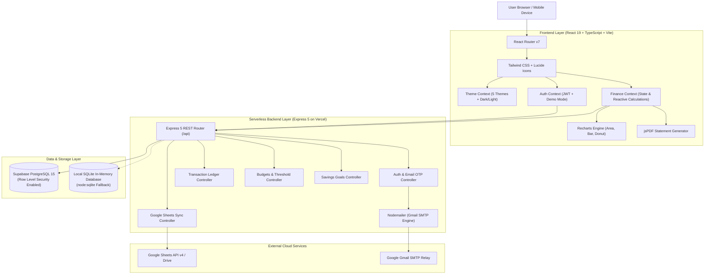
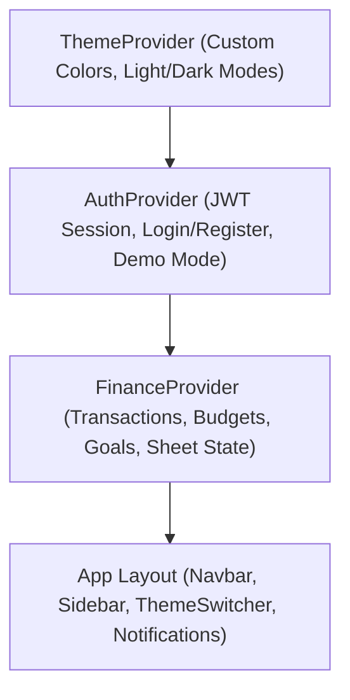
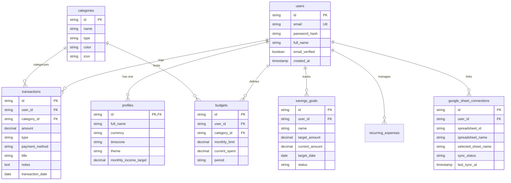

# System Architecture & Technical Design

## 1. High-Level Architecture

PaisaWise is architected as a high-performance, single-page application (SPA) backed by a serverless Express 5 REST API and a PostgreSQL database hosted on Supabase.



---

## 2. Frontend Layer (React 19 & TypeScript)

### Core Technologies
- **React 19 & React Router v7**: Component-driven architecture with clean client-side routing and protected route guards.
- **Tailwind CSS v3**: Mobile-responsive, utility-first styling with comprehensive dark mode support.
- **Recharts**: High-performance SVG-based visualizations for cash flow velocity, category allocation donuts, and daily expense trends.
- **jsPDF & jsPDF-AutoTable**: Client-side financial statement generation and audit-grade PDF export without backend dependency.

### State Management Hierarchy


- **`ThemeContext`**: Controls the active color palette (`professional-carbon`, `crimson-dusk`, `cobalt-steel`, `ember-glow`, `mint-frost`) and synchronizes dark/light classes on the document root.
- **`AuthContext`**: Manages user authentication state, token storage in `localStorage`, session restoration, and instant 1-click **Demo Mode** fallback.
- **`FinanceContext`**: Central state engine for all financial entities. Implements reactive computations (total income, total expense, net savings, budget utilization, financial health score) and triggers real-time updates across all components.

---

## 3. Backend API Layer (Express 5 & Node.js)

### Express 5 Serverless Architecture
The backend is structured into modular routers and compiled using `esbuild` into a single, high-efficiency CJS bundle (`api/index.js`) tailored for Vercel Serverless Functions.

- **Fast Cold Starts**: Single bundled artifact with all internal dependencies pre-inlined (`~1.9 MB`).
- **External Native Drivers**: `pg` and `node:sqlite` configured as external modules to prevent binary compilation mismatches.
- **Bcrypt Password Security**: Hashes passwords with 10 salt rounds prior to storage.
- **Real-Time Gmail SMTP Relay**: Directly contacts `smtp.gmail.com:465` with SSL/TLS encryption to deliver verified 6-digit OTP codes.

---

## 4. Database Schema & Models

PaisaWise utilizes a normalized relational schema with Row-Level Security (RLS) enabled across all tables.



---

## 5. Mathematical Precision & Determinism

### Floating-Point Error Elimination
JavaScript IEEE 754 floating-point arithmetic can introduce fractional rounding errors (e.g. `0.1 + 0.2 = 0.30000000000000004`). PaisaWise enforces strict cent-level precision:

```typescript
export function roundMoney(amount: number): number {
  return Math.round((amount + Number.EPSILON) * 100) / 100;
}
```

All aggregations (`totalIncome`, `totalExpense`, `remainingBudget`, `netSavings`) pass through `roundMoney` before presentation.

### Algorithmic Financial Health Score (0–100)
The Health Score is computed deterministically across 4 weighted vectors:
1. **Budget Adherence (40%)**: Ratio of actual spend to planned budget.
2. **Net Savings Rate (30%)**: Percentage of monthly income saved.
3. **Fixed Recurring Burden (15%)**: Ratio of fixed subscriptions and rent to monthly income.
4. **Expense Volatility (15%)**: Week-over-week consistency in non-discretionary spending.
