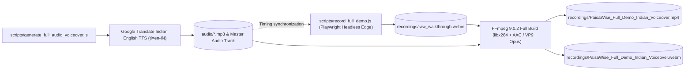

# Automated Demo Video Recording Pipeline

This document explains the automated pipeline engineered to generate the high-definition product walkthrough of PaisaWise, complete with **spoken Indian English voiceover** and frame-synchronized on-screen presenter captions.

---

## 1. Pipeline Architecture



---

## 2. Component Breakdown

### Step 1: Spoken Indian Voiceover Generation (`scripts/generate_full_audio_voiceover.js`)
- Uses Google Translate Indian English TTS (`tl=en-IN&client=tw-ob`) to generate natural pronunciation for Indian financial terms (`Rupees`, `Lakhs`, `Crores`, `UPI`).
- Splits complex narrative paragraphs into natural sentence chunks with audio buffering.
- Concatenates scene audio tracks into a master track: `audio/PaisaWise_Indian_Voiceover_Master.mp3` (`209.92` seconds / ~`3.5` minutes).

### Step 2: Automated Browser Navigation (`scripts/record_full_demo.js`)
- Runs Microsoft Edge in headless mode with Playwright at `1280×720` resolution at `25 fps`.
- Injects a styled, floating Indian presenter narrative card overlay displaying:
  - 🎙️ Microphone icon with Indian flag badge.
  - Spoken sentence quotes matching the audio track.
  - System highlight feature notes.
- Measures and synchronizes scene execution to match the exact duration of each corresponding audio file.

### Step 3: Full FFmpeg Audio & Video Muxing
- Combines the video frames from `raw_walkthrough.webm` with the master audio track using full FFmpeg build 9.0.2:
  ```powershell
  ffmpeg -i raw_walkthrough.webm -i PaisaWise_Indian_Voiceover_Master.mp3 `
    -c:v libx264 -preset fast -pix_fmt yuv420p `
    -c:a aac -b:a 192k -shortest `
    PaisaWise_Full_Demo_Indian_Voiceover.mp4 -y
  ```
- Also produces a native WebM version with `libopus` audio.

---

## 3. Scene Breakdown & Timing Map

| Scene | Duration | Module Covered | Actions Performed |
|---|---|---|---|
| **Scene 1** | `18.82s` | Brand Intro & Landing | Loads `/login`, smooth scroll through hero features and Rupee branding. |
| **Scene 2** | `22.54s` | Auth & Gmail OTP | Switches to registration, types user details, accepts Terms, and activates demo cockpit. |
| **Scene 3** | `20.64s` | Financial Cockpit | Displays KPI summary cards, scrolls over Recharts donut and daily trend charts. |
| **Scene 4** | `24.98s` | Transactions & UPI | Filters ledger by payment methods, opens Record modal, adds ₹2,450 UPI grocery expense. |
| **Scene 5** | `15.17s` | Budgets & 80% Alert | Displays category limits with 80% threshold warnings and utilization progress bars. |
| **Scene 6** | `17.47s` | Savings Goals | Milestone tracking; opens contribute modal and deposits ₹5,000 to Emergency Fund. |
| **Scene 7** | `14.86s` | Recurring Commitments | Audits fixed monthly commitments (House rent, insurance EMI, broadband, OTT). |
| **Scene 8** | `15.34s` | Analytics & Reports | Explores cash flow velocity curves and statement generation. |
| **Scene 9** | `26.50s` | Google Sheets Sync | Highlights connected Sheet ID, triggers Sync, copies TSV, and reveals direct data box. |
| **Scene 10** | `13.97s` | Theme Switcher | Switches UI to Mint Frost (Light Mode) and back to Professional Carbon (Dark Mode). |
| **Scene 11** | `19.66s` | Vercel Live Production | Navigates to `/api/health` (200 OK) and concludes on live production dashboard. |

---

## 4. How to Re-Record or Customize the Demo

1. Ensure dev server or production URL is accessible.
2. If modifying text or scenes, run:
   ```bash
   node scripts/generate_full_audio_voiceover.js
   ```
3. Run the automated recording and muxing script:
   ```bash
   node scripts/record_full_demo.js
   ```
4. Output videos will be written to `recordings/PaisaWise_Full_Demo_Indian_Voiceover.mp4`.
