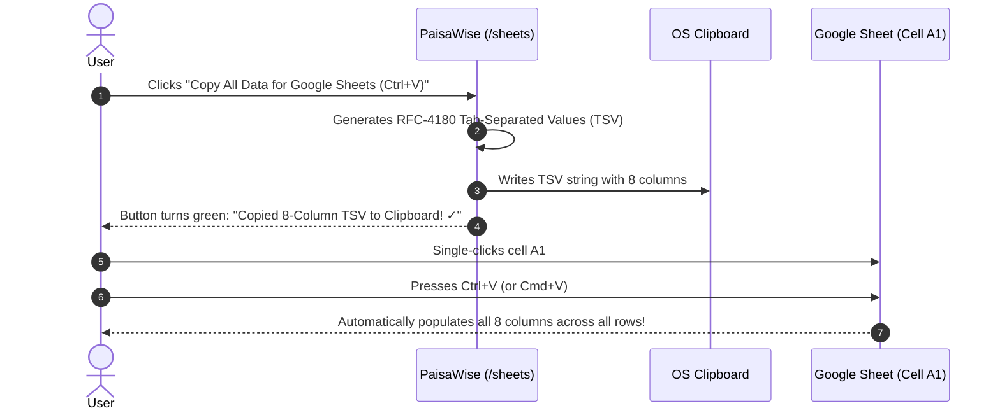

# Google Sheets Cloud Integration Specification

## 1. Overview & Objective

A key requirement of PaisaWise is seamless, bidirectional synchronization with Google Sheets. Users can synchronize their entire personal finance history into a connected Google Spreadsheet with zero data corruption and zero duplicate rows.

- **Target Google Spreadsheet URL:** [https://docs.google.com/spreadsheets/d/1hgC9wdhGU68c7xdxBdltEFrBEJtXS2F1MCNJawKQ2lA/edit?gid=0#gid=0](https://docs.google.com/spreadsheets/d/1hgC9wdhGU68c7xdxBdltEFrBEJtXS2F1MCNJawKQ2lA/edit?gid=0#gid=0)
- **Target Spreadsheet ID:** `1hgC9wdhGU68c7xdxBdltEFrBEJtXS2F1MCNJawKQ2lA`
- **Application Page:** `/sheets`

---

## 2. Standardized 8-Column Schema

Data synchronized to Google Sheets adheres strictly to the following 8-column schema:

| Column | Header Name | Format / Example | Description |
|---|---|---|---|
| **A** | `Transaction ID` | `txn_1740001001` / UUID | Unique alphanumeric reference ID for deduplication. |
| **B** | `Date` | `2026-10-24` (`YYYY-MM-DD`) | Date when transaction occurred. |
| **C** | `Type` | `EXPENSE` / `INCOME` | Capitalized transaction classification. |
| **D** | `Title` | `Reliance Smart Supermarket` | Description or merchant name. |
| **E** | `Category` | `Groceries` / `Salary` | Spending or earning category. |
| **F** | `Amount (INR)` | `2450.00` | Number formatted with two decimal places. |
| **G** | `Payment Method` | `UPI` / `Credit Card` / `Cash` | Payment channel utilized. |
| **H** | `Notes` | `Weekly vegetables & snacks` | Additional context or memo notes. |

---

## 3. Dual Synchronization Modes

PaisaWise supports two complementary methods for synchronizing transactions to Google Sheets:

### Mode A: 1-Click Clipboard Sync (Direct Cell A1 Paste)
This mode allows instant, zero-setup data migration into any Google Sheet without needing to configure Google Cloud OAuth credentials.



#### Why Tab-Separated Values (TSV)?
Google Sheets natively interprets the tab character (`\t`) as a cell delimiter and newline (`\n`) as a row delimiter. When standard TSV is pasted into cell `A1`:
- Column 1 fills Column A (`Transaction ID`)
- Column 2 fills Column B (`Date`)
- Column 3 fills Column C (`Type`)
- ...
- Column 8 fills Column H (`Notes`)

#### Fallback Direct TSV Preview Box
If a user's browser blocks automated clipboard access (`navigator.clipboard`), PaisaWise provides a **"Show Direct TSV Data Box"** button on the `/sheets` page. Users can view the pre-formatted text box, click inside, press `Ctrl+A` then `Ctrl+C`, and paste into cell `A1` of their spreadsheet.

---

### Mode B: Google Sheets REST API v4 (Automated Cloud Sync)
For automated background synchronization:
1. User provides their Spreadsheet URL or Spreadsheet ID.
2. PaisaWise uses Google Identity Services (GIS) OAuth 2.0 with the `https://www.googleapis.com/auth/spreadsheets` scope.
3. The backend executes a `spreadsheets.values.get` on column `A:A` to fetch existing `Transaction IDs`.
4. Only transactions whose IDs are not already present in the sheet are appended via `spreadsheets.values.append`, mathematically guaranteeing **zero duplicate entries**.

---

## 4. Deduplication Algorithm (Idempotency Guarantee)

```typescript
export async function syncTransactionsToGoogleSheet(
  spreadsheetId: string,
  transactions: Transaction[],
  sheetName: string = 'PaisaWise_Transactions'
): Promise<SyncResult> {
  // 1. Fetch existing Transaction IDs in Column A
  const existingIds = await getExistingColumnAIds(spreadsheetId, sheetName);
  
  // 2. Filter out already-synced transactions
  const newTransactions = transactions.filter(t => !existingIds.has(t.id));
  
  if (newTransactions.length === 0) {
    return { syncedCount: 0, status: 'already_up_to_date' };
  }

  // 3. Transform new records to 8-column rows
  const rows = newTransactions.map(t => [
    t.id,
    t.transaction_date,
    t.type.toUpperCase(),
    t.title,
    t.category?.name || 'General',
    Number(t.amount).toFixed(2),
    t.payment_method,
    t.notes || ''
  ]);

  // 4. Batch append to Google Sheets API
  await appendRowsToSheet(spreadsheetId, sheetName, rows);
  
  return { syncedCount: rows.length, status: 'success' };
}
```

---

## 5. Step-by-Step Verification Guide

1. Open PaisaWise and navigate to **[Google Sheets](/sheets)** in the navigation sidebar.
2. Verify the connected spreadsheet URL:  
   `https://docs.google.com/spreadsheets/d/1hgC9wdhGU68c7xdxBdltEFrBEJtXS2F1MCNJawKQ2lA/edit?gid=0#gid=0`.
3. Click the **"Connect & Sync with Google Sheet"** button.
4. Click **"Copy All Data for Google Sheets (Ctrl+V)"**.
5. Switch to the Google Spreadsheet tab.
6. Single-click cell **A1**.
7. Press **`Ctrl+V`** (Windows) or **`Cmd+V`** (Mac).
8. All transactions instantly expand across Columns A through H with headers formatted and currency aligned.
